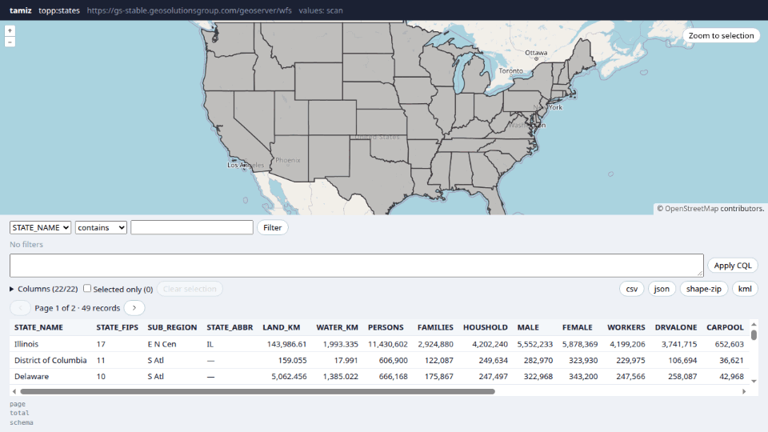

# <picture><source media="(prefers-color-scheme: dark)" srcset=".github/assets/icon-dark.svg"></picture> tamiz

[](https://www.npmjs.com/package/@npmegar/tamiz)
[](https://bundlejs.com/?q=@npmegar/tamiz)
[](LICENSE)

Headless attribute table for WFS/GeoServer layers: CQL filters, paging, download and selection synced with OpenLayers.



**[Live demo](https://ghegar.github.io/tamiz/)**

tamiz owns the state — schema, paging, sorting, column filters turned into CQL, hand-written CQL,
column visibility and order, selection, downloads — and you own every pixel: it ships no styles, only
state, events and ARIA/`data-*` attributes. An optional bridge keeps the selection in sync with an
OpenLayers map.

## Install

```bash
npm install @npmegar/tamiz
```

| Entry | What it is | Needs |
|---|---|---|
| `@npmegar/tamiz` | Framework-free core: WFS client, CQL builder, table store | nothing |
| `@npmegar/tamiz/react` | `useAttributeTable` with prop getters, `useDistinctValues` | `react >= 19` |
| `@npmegar/tamiz/ol` | `bindOlSelection`: highlight, click to select, zoom to selection | `ol >= 10` |

## Quick start

```ts
import { createAttributeTable } from '@npmegar/tamiz';
import { bindOlSelection } from '@npmegar/tamiz/ol';

const table = createAttributeTable({
    source: { url: 'https://example.org/geoserver/wfs', typeName: 'ws:municipalities', version: '2.0.0' },
    pageSize: 50,
});

table.subscribe(() => render(table.getSnapshot()));
table.start();

table.setFilter('population', { kind: 'number', op: 'gt', value: 10000 });
bindOlSelection(table, map, { style: { 'stroke-color': '#e4572e', 'stroke-width': 3 } });
```

## Core

```ts
import { createAttributeTable } from '@npmegar/tamiz';

const table = createAttributeTable({
    source: { url: 'https://example.org/geoserver/wfs', typeName: 'ws:municipalities', version: '2.0.0' },
    pageSize: 100,
    idField: null,
    baseCql: "year = 2026",
});

table.subscribe(() => render(table.getSnapshot()));
table.start();

table.setFilter('population', { kind: 'number', op: 'between', min: 1000, max: 5000 });
table.setFilter('name', { kind: 'text', op: 'contains', value: 'san' });
table.toggleSort('population');
table.setPage(1);
table.setCql("name ILIKE 'z%'");
table.setColumnVisible('geom_area', false);
table.moveColumn('name', 0);
table.select('municipalities.12', 'range');
table.setOnlySelected(true);

const url = table.downloadUrl({ format: 'shape-zip', filename: 'selection' });
const { blob, filename } = await table.download({ format: 'csv' });
```

### Requests and paging

Nothing is fetched until `start()`. Several changes in the same tick become one request; a new query
aborts the request in flight. Changing the query resets the page to 0. The total comes from
`numberMatched` when the server sends it, or from a `resultType=hits` request.

GeoServer needs a `sortBy` to page tables without a primary key. `stableSort: true` sorts every page
by the first field when the user has not picked a sort (or pass a field name); the snapshot's `sort`
stays `null`.

### Snapshot

| Field | Meaning |
|---|---|
| `status`, `error` | `idle`, `loading`, `ready` or `error`; the WFS exception text when it fails |
| `schema` | Fields with their family (`text`, `number`, `date`, `boolean`) and the geometry field |
| `columns`, `visibleColumns` | Ordered columns with `label`, `visible`, `sort` and `filter` |
| `rows` | The current page: `{ id, properties }` |
| `page`, `pageSize`, `pageCount`, `total` | Paging |
| `cql` | The effective expression sent to the server |
| `baseCql`, `customCql`, `filtersCql` | Its parts: inherited, hand-written, built from column filters |
| `chips` | One per active condition, with `label`, `source` and `removable`; remove with `removeChip(key)` |
| `selection`, `onlySelected` | Selected ids and whether the table shows only them |

### Filters

| Kind | Shape | CQL |
|---|---|---|
| `list` | `{ values }` | `col IN (…)` |
| `text` | `{ op: 'contains' \| 'startsWith' \| 'endsWith' \| 'equals', value, caseSensitive? }` | `ILIKE` / `LIKE` |
| `number` | `{ op: 'eq' \| 'ne' \| 'lt' \| 'lte' \| 'gt' \| 'gte', value }` or `{ op: 'between', min, max }` | comparison / `BETWEEN` |
| `date` | `{ from?, to?, before? }` (ISO strings; `before` is exclusive) | `>=` / `<=` / `<` |
| `boolean` | `{ value }` | `col = true` |
| `null` | `{ isNull }` | `IS NULL` / `IS NOT NULL` |

Text filters escape `%`, `_` and `\`, so they match those characters literally. Use a hand-written
CQL when you need wildcards.

### Composing the CQL

A hand-written CQL (`setCql`) replaces the column filters until it is removed; they are kept and come
back. `baseCql` is the condition the table inherits (for example, the map's filters) and it is never
removable from the table. Chip labels are English by default; pass `labels` to translate them.

### Distinct values

WFS has no way to ask for the distinct values of a column, so `fetchDistinct` picks a strategy from
the `distinct` option:

```ts
const table = createAttributeTable({ source, distinct: 'scan' });

const { values, complete } = await table.fetchDistinct('region', { limit: 200, search: 'atl' });
```

| Strategy | How | Trade-off |
|---|---|---|
| `'scan'` (default) | One `GetFeature` page of that column alone, sorted, deduplicated | Any WFS; a page full of repeated values can cut the list short |
| `'wps'` | GeoServer's `gs:PagedUnique` process | Exact, but needs the WPS extension; with `limit` it returns an arbitrary subset |
| `(query) => Promise<{ values, complete }>` | Your own source | Values you already know or keep in a catalog |

The values honor the table's query except the column's own filter, so picking values for `region`
is not narrowed by the regions already picked. `applyQuery: false` ignores the query. `search`
narrows text columns on the server and the rest on the client. Values come sorted; `complete` is
`false` when there may be more. The WPS endpoint is the WFS URL with `/wfs` replaced by `/wps`, or
`source.wpsUrl`. `scanDistinct` and `wpsDistinct` are exported to build your own fallback.

### Ids

With `idField: null` rows use the WFS feature id (`layer.123`) and selections filter with
`IN ('layer.123')`. With an attribute name they use that attribute.

## React

```tsx
import { useAttributeTable } from '@npmegar/tamiz/react';

function Grid({ table }) {
    const t = useAttributeTable(table);
    return (
        <table {...t.getTableProps()}>
            <thead>
                <tr>{t.visibleColumns.map(c => <th key={c.name} {...t.getHeaderProps(c)}>{c.label}</th>)}</tr>
            </thead>
            <tbody>
                {t.rows.map((row, i) => (
                    <tr key={row.id} {...t.getRowProps(row, i)}>
                        {t.visibleColumns.map(c => <td key={c.name} {...t.getCellProps(row, c)}>{String(row.properties[c.name])}</td>)}
                    </tr>
                ))}
            </tbody>
        </table>
    );
}
```

Headers toggle sorting (ascending, descending, default). Rows select on click, toggle with Ctrl/⌘,
select a range with Shift, and toggle with Space or Enter. `getColumnToggleProps` fits a checkbox.

```tsx
const { values, complete, status } = useDistinctValues(table, 'region', { search, limit: 100 });
```

`useDistinctValues` waits until the table has started and knows its schema, asks again when the
query, column or options change, and aborts the request it no longer needs.

## OpenLayers

```ts
import { bindOlSelection } from '@npmegar/tamiz/ol';

const selection = bindOlSelection(table, map, {
    style: { 'stroke-color': '#e4572e', 'stroke-width': 3 },
    hitTolerance: 4,
    applyQuery: true,
    pick: 'first',
});
selection.zoomToSelection();
selection.destroy();
```

The bridge adds a vector layer, fetches the geometries of the selected ids in the view projection,
and turns map clicks into a `BBOX` query combined with the table's CQL. A plain click replaces the
selection; Ctrl, ⌘ or Shift toggle. It asks for up to `maxFeatures` (50) features and keeps those
whose geometry touches the click. `pick: 'first'` (default) takes the one drawn on top: the WMS paints
in the layer's natural order, so that is the last one returned. `pick: 'all'` takes every touched
feature, and a function `(features, coordinate) => features` decides for styles that reorder with
`sortBy` or z-order. It does not touch your WMS layer: pass `snapshot.cql` to its `CQL_FILTER` if the
map should follow the table.

## Known limitations

- Built for GeoServer WFS 2.0.0 and 1.1.0: `CQL_FILTER` is a GeoServer vendor parameter.
- Without a primary key GeoServer cannot page unless every request has a `sortBy`: use `stableSort`.
- `'scan'` distinct values can come out short when one page is full of repeated values; `'wps'` needs
  the WPS extension and, with `limit`, returns an arbitrary subset.
- With more than `maxFeatures` features under a map click, the one on top may not be among them.
- In WFS 2.0 with `EPSG:4326` GeoServer answers in lat/lon order. The bridge always asks for the view
  projection, so it is not affected; a request in `EPSG:4326` made by hand is.
- Virtualizing long pages is up to you.

## Development

```bash
npm test
npm run lint
npm run typecheck
npm run demo
npm run e2e
```

The demo opens a table and a map against a public GeoServer (`topp:states`). Point it at another
server with `?wfs=…&type=ws:layer&version=1.1.0&wms=…`, and ask distinct values through WPS with
`?distinct=wps`. `npm run e2e` runs Playwright against the demo and that live server.

## Contributing

Issues are welcome. Open one before sending a pull request.

## License

AGPL-3.0-only © GHEgar
